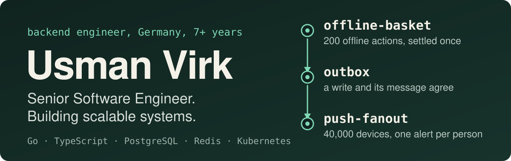

  

I build backend services, the data models under them, and the deployment and monitoring around them. Most of this profile is about what happens when a network, a queue or a rollout misbehaves.

Each project says what it covers and where it stops. Together they carry 568 automated tests, and the ones that need Postgres, Redis or RabbitMQ run against the real service.

_These projects were built with AI assistance._

## Start here

| Project | What it shows |
| --- | --- |
| [offline-basket](https://github.com/usman-bk/offline-basket) | A cart that survives a dead signal: 200 offline actions, settled once |
| [query-plans](https://github.com/usman-bk/query-plans) | Four queries fixed, including a textbook N+1 fix that ran 600 times slower |
| [push-fanout](https://github.com/usman-bk/push-fanout) | One price drop to 40,000 devices, one notification per person |

## Mobile backends

- [mobile-bff](https://github.com/usman-bk/mobile-bff): payloads cut from 270 KB to 3.4 KB, with the budget enforced by a test
- [ts-api-client](https://github.com/usman-bk/ts-api-client): a React Native API client with single-flight refresh and full jitter
- [price-watch](https://github.com/usman-bk/price-watch): one feature across Go, React Native and Vue, with a generated contract

## Reliability

- [cache-stampede](https://github.com/usman-bk/cache-stampede): 2,000 origin calls collapsed into 1 when a popular key expires
- [outbox](https://github.com/usman-bk/outbox): a database write and its published message that cannot disagree
- [k8s-rollout](https://github.com/usman-bk/k8s-rollout): why rolling deploys return 502s, and the drain order that stops it
- [app-session](https://github.com/usman-bk/app-session): refresh token rotation where a stolen token ends the whole family

## APIs and data

- [contract-checks](https://github.com/usman-bk/contract-checks): fails a pull request that would break an app already on a phone
- [api-versioning](https://github.com/usman-bk/api-versioning): four live versions of one endpoint, pinned by golden files
- [graded-catalogue](https://github.com/usman-bk/graded-catalogue): a marketplace where every unit is one of a kind

## Contact

[LinkedIn](https://www.linkedin.com/in/usman-virk)
